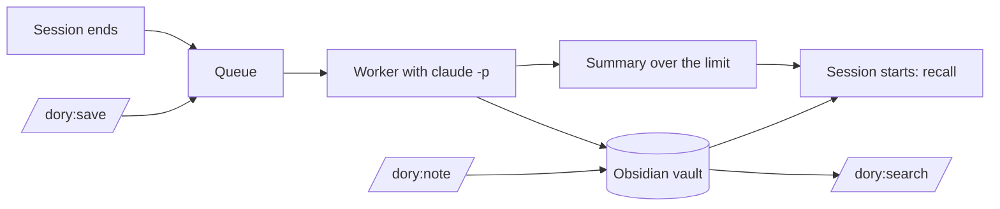

# 🐠 Dory

A memory for Claude Code. When a session ends, a background process writes what was learned in it into an Obsidian vault: one knowledge file per project, and one file per topic for what applies everywhere. When a new session starts, Claude gets back what is already known: the pitfalls, decisions and facts of the project, the notes you wrote for it, and the titles of everything else, to read when it matters.

The notes are plain Markdown, so you can browse them in Obsidian. They are written in the language you configure, English by default.

## What you get

### Automatically

- **When a session ends** (`/exit`, `/clear`, closing the tab, Ctrl+C), it goes into a queue. A worker processes it in the background with `claude -p` and writes:
  - a session note: what was done, which knowledge entries came out of it, what is still open
  - entries in the project's `knowledge.md`, only for what really matters: a pitfall, a decision the repository does not record, a fact about a system outside the code, a how-to, a preference. Most sessions add none. An entry opens with its statement in bold (`**Loki only starts if UID 10001 owns the data directory.**`) followed by at most three sentences, and states the current state without progress, effort or commit hashes. What the project's CLAUDE.md already says does not become an entry, and what a record says becomes at most a short pointer to the record.
  - entries kept current: an entry on the same subject is extended rather than duplicated; when a session shows it is wrong, it is corrected in place; an entry the CLAUDE.md now states is removed
  - knowledge that applies beyond the project into one file per topic in `notes/` (`notes/Notion.md`), extended when the topic exists. Private matters (family, health, money, your own devices and home network) become no entry anywhere.
  - changes to lists such as the shopping list, if the session touched them
- **After every run**, dory compares the knowledge and topic files with their state before it. A removed entry, a rewritten lead, a change to one of your notes or to `private/`, and a file the run had no business writing are listed in `runs.log`, and `dory status` shows today's counts. Nothing of yours is undone: the snapshot is the way back.
- **When a session starts**, a hook injects the project's notes and knowledge as the files are, each private note one of your project notes links, and then the title of every file in `notes/`, so Claude reads a topic when the session touches it. When the project's files no longer fit the limit, it loads a summary the worker made of them in the background, with the paths of the full files. Sessions of the project still waiting in the queue are listed with the path to their transcript. What happened in recent sessions is not injected: you know it, and `/dory:search` finds it.

### Commands in Claude Code

| Command | What it does |
|---|---|
| `/dory:save` | Queues the running session right away without ending it. When it ends later, only the rest is processed, as part 2. |
| `/dory:note "how we solved the Loki port"` | Writes a note into the project's `notes/`, as a file named by its title; Claude writes title and content from what you ask and from the session. "remember in general: ..." goes into the matching topic in `notes/`, "buy milk" onto the shopping list. Something private is not written: put it into `private/` yourself. The worker reads your notes and never changes them. |
| `/dory:search loki deploy` | Searches the whole vault, `private/` included, and shows each matching entry with its section and file, and each matching note, list or session note. Claude also uses it on its own when you ask about earlier knowledge. |

### In the terminal

```bash
dory status   # queue, failed entries with reason, last error, API equivalent cost, today's checks
dory retry    # move failed entries back into the queue
dory add-note --scope project --title "Loki port" "Loki runs on 3200."   # creates a note file; /dory:note runs it
```

`dory` is in the installed plugin: `~/.claude/plugins/cache/brain/dory/<version>/bin/dory`.

## Requirements

- macOS (snapshots and transcript copies use APFS clones)
- [Claude Code](https://claude.com/claude-code), signed in with your Claude subscription
- [uv](https://docs.astral.sh/uv/) on your `PATH`; it runs the plugin's Python scripts
- [Obsidian](https://obsidian.md) to browse the notes, optional

## Installation

```bash
claude plugin marketplace add cheorges/dory
claude plugin install dory@brain
```

Restart Claude Code. From the next session on, ended sessions land in `~/Obsidian/dory-brain`; to use another folder or language, see [Configuration](#configuration). In Obsidian, open the folder with *Open folder as vault*.

To update:

```bash
claude plugin marketplace update brain
claude plugin update dory@brain
```

To remove:

```bash
claude plugin uninstall dory@brain
```

The vault and the state directory stay where they are.

## Configuration

Create `~/.config/dory-brain/config.toml` if you want to change a default:

```toml
vault = "~/Obsidian/dory-brain"  # where the notes live; not in iCloud Drive, which offloads files
language = "English"             # language the notes are written in, e.g. "German"
model = "sonnet"                 # worker model; "haiku" uses far less of your usage limit
```

`DORY_VAULT` and `DORY_STATE_DIR` override the vault and the state directory.

### Advanced settings

Change these only if you have a reason.

| Setting | Default | Purpose |
|---|---|---|
| `recall_budget_tokens` | `1500` | The limit for what a session start injects; it sits in the context of every session. When the whole text exceeds it and a project's files alone exceed 80 % of it, a summary loads instead of the files. More costs every session; less means a summary sooner. |
| `min_user_messages` | `3` | Sessions with fewer messages from you are skipped, so a quick question does not cost a worker run. Counted over the whole session. |
| `condense_max_tokens` | `30000` | Upper limit for the condensed transcript the worker reads. Longer sessions keep their beginning and end; the middle is cut. |
| `worker_timeout_minutes` | `10` | Without a network, `claude -p` hangs instead of failing. The timeout stops it so the queue keeps moving. Real runs take 20 to 60 seconds. |
| `snapshots_keep` | `50` | How many vault snapshots are kept for undo. A snapshot is taken before every write; APFS clones cost almost no disk space. |

## How it works



### Queue

The `SessionEnd` hook clones the transcript to `~/.local/state/dory-brain/transcripts/`, queues an entry and starts the worker detached. Claude Code does not wait for it.

### Worker

One worker runs at a time (file lock). For each entry:

1. The transcript is condensed: only what you and Claude wrote is kept. Tool output, attachments and command wrappers are dropped because they carry foreign text and personal data. Secrets are redacted first. Lines processed before are skipped.
2. The vault is snapshotted (see [Undoing a change](#undoing-a-change)).
3. `claude -p` processes the bundle with the writing rules from `plugin/skills/rules/SKILL.md`. The run is restricted (`--restricted`): it sees only the vault and its own bundle, no CLAUDE.md, no settings, no other plugins.
4. A run only counts as a success if the session note exists. On a rate limit or network error the entry stays in the queue and is retried next time. After three real failures it moves to `failed/`, which `dory status` shows.
5. The run cannot read or write `private/` and cannot write your notes in `projects/<project>/notes/`: its settings deny it. After every run that changed the vault, dory checks it against the state before: it restores the frontmatter keys that place a file (`type`, `domain`, `paths` of `knowledge.md`, the `type` of a file in `notes/`), lists every change to your notes, to `private/` and to other files the run had no business writing, and compares the entries of `knowledge.md` and the topic files. `runs.log` lists each change.
6. After the queue, the worker writes a summary for every project whose files exceed 80 % of `recall_budget_tokens`: the project of each session it processed, and every project a session start or `/dory:note` asked for. The run has no tools and gets the files as data; the summary is stored under `~/.local/state/dory-brain/summaries/` with the hash of the text it was made from and the private notes it covered.

### Projects

A project is a git repository. Worktrees belong to their main repository. Sessions outside a repository have no project; their knowledge goes into topic files or lists in `notes/`.

### Work and private

`private/` is your folder: dory never writes into it and the worker cannot read it. A private note reaches a session only when one of the project's notes links it, in the form Obsidian writes (`[[private/Employment contract]]`, `[[Employment contract]]`, an embed or a Markdown link); links inside a private note are not followed. A project is work unless its `knowledge.md` says `domain: private`; to mark one, change that line in its frontmatter. A private project's sessions write no topic file, since every session lists the topics. Search covers everything, `private/` included: it is your own request. The boundary only applies to what is loaded; Claude can still read the vault directly.

### Session start

| Session in | Loads in full | Lists |
|---|---|---|
| a project | the project's notes by name, each followed by the private notes it links, then its `knowledge.md` | every file in `notes/` |
| no repository, or a repository dory does not know yet | nothing | every file in `notes/` |

While the whole text fits `recall_budget_tokens`, everything loads. When the project's files do not fit, their summary loads once they exceed 80 % of the limit, followed by their paths; otherwise they load cut at the limit. If the files changed since the summary was made, the old summary loads with a line saying so, and the worker makes a new one; a summary made with other linked private notes is not used. The titles of `notes/` fill what is left, most recently updated first, and a last line says how many did not fit.

## The vault

```text
<vault>/
  projects/
    ai-assistant-hub/
      knowledge.md                           the project's knowledge, kept by the worker
      notes/
        Loki port.md                         your notes for the project, one file each
  notes/
    Notion.md                                a topic, kept by the worker (type: topic)
    Shopping list.md                         list
    Invoices.md                              register
  private/
    Employment contract.md                   yours alone; loads when a project note links it
  sessions/2026/10/
    2026-10-09-1432-ai-assistant-hub-abc12345-1.md
```

All files are Obsidian Flavored Markdown with properties in the frontmatter and `[[wikilinks]]`. A file name is its title. Other files in `projects/` (single knowledge notes and overviews from before 0.4.0, a project's `notes.md` from 0.4.0) and the folder `general/` from 0.4.0 are no longer loaded, searched or changed; move what you want to keep and delete them. Keep the overview of a project you had marked `domain: private` until its `knowledge.md` exists, or set the domain there yourself.

### Undoing a change

The vault has no git. Before every write, dory takes a snapshot (an APFS clone, the last 50 are kept). It is also the way back for an entry a run removed: `runs.log` names the run. Restore a file from there:

```bash
ls ~/.local/state/dory-brain/snapshots/
cp ~/.local/state/dory-brain/snapshots/<timestamp>/projects/x/knowledge.md ~/Documents/dory/projects/x/
```

## Cost

The worker runs on your Claude subscription, not on the API. It removes `ANTHROPIC_API_KEY` from its environment so an API key is never used. The runs count against your usage limit like a normal session.

`dory status` shows an amount in USD anyway: the API equivalent that `claude -p` reports for each run. On 10 real sessions with `sonnet` it was 0.18 to 0.35 USD per session, 20 to 60 seconds each. `haiku` needs about a fifteenth of that.

## Development

```bash
uv run pytest -q && uv run ruff check .     # tests and linter
DORY_LIVE=1 uv run pytest -m live           # live checks against real claude -p (counts against your limit)
```

The live checks use Haiku (`DORY_LIVE_MODEL=sonnet` for another model) and throwaway vaults.

To run the plugin from a clone, add the clone as the marketplace instead: `claude plugin marketplace add ~/Development/dory`. Claude Code then loads the plugin in place, so changes take effect at the next session start or after `/reload-plugins`.

Design and decisions: [Record 001](docs/records/001-second-brain.md), [Record 002](docs/records/002-note-quality.md), [Record 003](docs/records/003-project-knowledge-file.md). What was built and checked per story: [implementation log](docs/implementation-log.md).

## License

[Apache License 2.0](LICENSE). You may use, change and redistribute dory, also commercially. Redistributions and products built on it must include the [NOTICE](NOTICE) file, which credits the author. Changes per version are in the [changelog](CHANGELOG.md).
