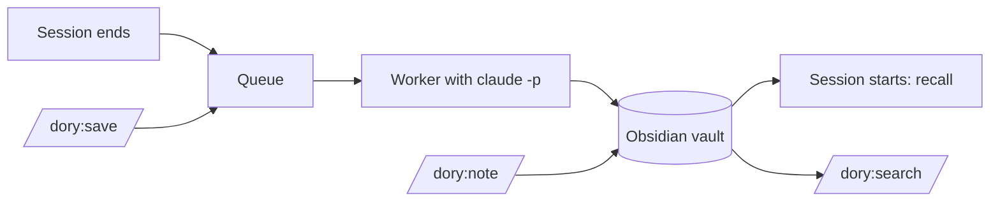

# 🐠 Dory

A memory for Claude Code. When a session ends, a background process writes what was learned in it as notes into an Obsidian vault. When a new session starts, Claude gets back what is already known: the pitfalls, decisions and facts of the project and the ones that apply everywhere.

The notes are plain Markdown, so you can browse them in Obsidian. They are written in the language you configure, English by default.

## What you get

### Automatically

- **When a session ends** (`/exit`, `/clear`, closing the tab, Ctrl+C), it goes into a queue. A worker processes it in the background with `claude -p` and writes:
  - a session note: what was done, which notes came out of it, what is still open
  - knowledge notes, only for what really matters: a pitfall, a decision the repository does not record, a fact about a system outside the code (decision, gotcha, how-to, fact, preference). Most sessions yield none. A note is named after what it says (`Loki startet nur, wenn UID 10001 das Datenverzeichnis besitzt.md`) and states the current state without progress, effort or commit hashes. What the project's CLAUDE.md already says does not become a note, and what a record says becomes at most a short pointer to the record.
  - notes kept current: a note on the same topic is extended rather than duplicated; when a session shows it is wrong, it is corrected and gets a new title, and dory renames the file and every link to it. A note whose content the CLAUDE.md now states is deleted and leaves the project overview, unless another project lists it too.
  - the project overview with its knowledge notes and sessions
  - changes to lists such as the shopping list, if the session touched them
- **When a session starts**, a hook injects what Claude should know: the project, its knowledge notes and matching knowledge from elsewhere. Whatever does not fit the budget is listed with its path in a catalog. Sessions of the project still waiting in the queue are listed with the path to their transcript. What happened in recent sessions is not injected: you know it, and `/dory:search` finds it.

### Commands in Claude Code

| Command | What it does |
|---|---|
| `/dory:save` | Queues the running session right away without ending it. When it ends later, only the rest is processed, as part 2. |
| `/dory:note "Loki port 3100 clashes with Grafana"` | Writes a note straight into the vault after taking a snapshot. In a project it becomes a knowledge note; `/dory:note "buy milk"` in `~` goes onto the shopping list. |
| `/dory:search loki deploy` | Searches the vault and shows summary and path of each hit. Claude also uses it on its own when you ask about earlier knowledge. |

### In the terminal

```bash
dory status   # queue, failed entries with reason, last error, API equivalent cost
dory retry    # move failed entries back into the queue
```

`dory` is in the installed plugin: `~/.claude/plugins/cache/brain/dory/<version>/bin/dory`.

## Requirements

- macOS (snapshots and transcript copies use APFS clones)
- [Claude Code](https://claude.com/claude-code), signed in with your Claude subscription
- [uv](https://docs.astral.sh/uv/) on your `PATH`; it runs the plugin's Python scripts
- [Obsidian](https://obsidian.md) to browse the notes, optional

## Installation

```bash
claude plugin marketplace add cheorges/dory
claude plugin install dory@brain
```

Restart Claude Code. From the next session on, ended sessions land in `~/Obsidian/dory-brain`; to use another folder or language, see [Configuration](#configuration). In Obsidian, open the folder with *Open folder as vault*.

To update:

```bash
claude plugin marketplace update brain
claude plugin update dory@brain
```

To remove:

```bash
claude plugin uninstall dory@brain
```

The vault and the state directory stay where they are.

## Configuration

Create `~/.config/dory-brain/config.toml` if you want to change a default:

```toml
vault = "~/Obsidian/dory-brain"  # where the notes live; not in iCloud Drive, which offloads files
language = "English"             # language the notes are written in, e.g. "German"
model = "sonnet"                 # worker model; "haiku" uses far less of your usage limit
```

`DORY_VAULT` and `DORY_STATE_DIR` override the vault and the state directory.

### Advanced settings

Change these only if you have a reason.

| Setting | Default | Purpose |
|---|---|---|
| `recall_budget_tokens` | `1500` | What a session start injects sits in the context of every session. More costs every session; less pushes knowledge notes into the catalog, where only their path appears. |
| `min_user_messages` | `3` | Sessions with fewer messages from you are skipped, so a quick question does not cost a worker run. Counted over the whole session. |
| `condense_max_tokens` | `30000` | Upper limit for the condensed transcript the worker reads. Longer sessions keep their beginning and end; the middle is cut. |
| `worker_timeout_minutes` | `10` | Without a network, `claude -p` hangs instead of failing. The timeout stops it so the queue keeps moving. Real runs take 20 to 60 seconds. |
| `snapshots_keep` | `50` | How many vault snapshots are kept for undo. A snapshot is taken before every write; APFS clones cost almost no disk space. |

## How it works



### Queue

The `SessionEnd` hook clones the transcript to `~/.local/state/dory-brain/transcripts/`, queues an entry and starts the worker detached. Claude Code does not wait for it.

### Worker

One worker runs at a time (file lock). For each entry:

1. The transcript is condensed: only what you and Claude wrote is kept. Tool output, attachments and command wrappers are dropped because they carry foreign text and personal data. Secrets are redacted first. Lines processed before are skipped.
2. The vault is snapshotted (see [Undoing a change](#undoing-a-change)).
3. `claude -p` processes the bundle with the writing rules from `plugin/skills/rules/SKILL.md`. The run is restricted (`--restricted`): it sees only the vault and its own bundle, no CLAUDE.md, no settings, no other plugins.
4. A run only counts as a success if the session note exists. On a rate limit or network error the entry stays in the queue and is retried next time. After three real failures it moves to `failed/`, which `dory status` shows.
5. After a successful run, dory carries out what the run marked but cannot do itself: it renames a corrected note to its new title (`rename_to`) and deletes a note marked `status: archived`, and rewrites or removes every link to them in the vault. It acts only on marks the run itself wrote: a mark left by a run that failed is reset. It touches only knowledge notes, skips a note whose file name another note shares, and deletes only a note that belongs to the session's project alone. Each rename or deletion is all or nothing: if a file cannot be written, the files already changed are put back and the mark is reset, and `dory status` shows the failure as the last error. `runs.log` lists each change.

### Projects

A project is a git repository. Worktrees belong to their main repository. Sessions outside a repository have no project; their knowledge goes to `general/` or into lists under `notes/`.

### Work and private

Every note has `domain: work` or `private`. In a session in a work project, the start injects nothing private, not even in the catalog, and search does not show it. Outside a repository both are visible. The boundary only applies to what is loaded and searched; Claude can still read the vault directly.

### Ranking at start

Pinned notes first (`pinned: true`), then those with the most sources, then the most recently updated. Superseded notes from earlier versions and notes marked for deletion are never loaded, and `/dory:search` does not show them either.

## The vault

```text
<vault>/
  projects/
    ai-assistant-hub/
      ai-assistant-hub.md                    project overview (knowledge, sessions)
      Loki startet nur, wenn UID 10001 das Datenverzeichnis besitzt.md
                                             knowledge note, named after what it says
  general/
    Python-Pakete mit uv statt pip.md        knowledge without a project
  notes/
    shopping-list.md                         list
    invoices.md                              register
  sessions/2026/10/
    2026-10-09-1432-ai-assistant-hub-abc12345-1.md
```

All notes are Obsidian Flavored Markdown with properties in the frontmatter and `[[wikilinks]]`. To pin a note, set `pinned: true`.

### Undoing a change

The vault has no git. Before every write, dory takes a snapshot (an APFS clone, the last 50 are kept). It is also the way back for a note dory renamed or deleted. Restore a file from there:

```bash
ls ~/.local/state/dory-brain/snapshots/
cp ~/.local/state/dory-brain/snapshots/<timestamp>/projects/x/"<title>.md" ~/Documents/dory/projects/x/
```

## Cost

The worker runs on your Claude subscription, not on the API. It removes `ANTHROPIC_API_KEY` from its environment so an API key is never used. The runs count against your usage limit like a normal session.

`dory status` shows an amount in USD anyway: the API equivalent that `claude -p` reports for each run. On 10 real sessions with `sonnet` it was 0.18 to 0.35 USD per session, 20 to 60 seconds each. `haiku` needs about a fifteenth of that.

## Development

```bash
uv run pytest -q && uv run ruff check .     # tests and linter
DORY_LIVE=1 uv run pytest -m live           # live checks against real claude -p (counts against your limit)
```

The live checks use Haiku (`DORY_LIVE_MODEL=sonnet` for another model) and throwaway vaults.

To run the plugin from a clone, add the clone as the marketplace instead: `claude plugin marketplace add ~/Development/dory`. Claude Code then loads the plugin in place, so changes take effect at the next session start or after `/reload-plugins`.

Design and decisions: [Record 001](docs/records/001-second-brain.md). What was built and checked per story: [implementation log](docs/implementation-log.md).

## License

[Apache License 2.0](LICENSE). You may use, change and redistribute dory, also commercially. Redistributions and products built on it must include the [NOTICE](NOTICE) file, which credits the author. Changes per version are in the [changelog](CHANGELOG.md).
