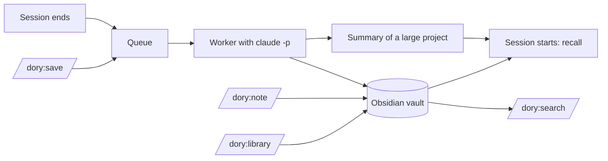

# 🐠 Dory

A memory for Claude Code. When a session ends, a background process writes what was learned into an Obsidian vault: one knowledge file per project and one file per topic for what applies everywhere. When a new session starts, Claude gets that knowledge back, together with the notes you wrote for the project.

The notes are plain Markdown in the language you configure (English by default), so you can read and edit them in Obsidian.

## What you get

**When a session ends** (`/exit`, `/clear`, closing the tab, Ctrl+C), it goes into a queue. A worker processes it in the background with `claude -p` and writes:

- a session note: what was done, which entries came out of it, what is still open
- entries in the project's `knowledge.md`, only for what matters later: a pitfall, a decision the repository does not record, a fact about a system outside the code, a how-to, a preference. Most sessions add none. An entry opens with its statement in bold (`**Loki only starts if UID 10001 owns the data directory.**`) and has at most three more sentences. The worker extends an entry on the same subject instead of adding a second one, corrects it when a session shows it is wrong, and removes it once the project's CLAUDE.md says the same.
- knowledge that applies beyond the project into a topic file in `notes/` (`notes/Notion.md`). Private matters (family, health, money, your own devices and home network) become no entry anywhere.
- changes to lists such as the shopping list, if the session touched them

**When a session starts**, a hook gives Claude the project's notes and `knowledge.md`, the library entries those notes link, then as many topic files from `notes/` as fit, each with the library entries it links, and the titles of the rest. How much it may load is a level you choose (see [Configuration](#configuration)). A project too large for that gets a summary instead. Recent sessions are not loaded; `/dory:search` finds them.

**After every worker run**, dory compares the vault with its state before the run and lists removed entries, rewritten leads, changes to your notes or to `library/`, and files the run should not have touched in `runs.log`. `dory status` shows today's counts. Nothing of yours is undone automatically; snapshots are the way back.

### Commands in Claude Code

| Command | What it does |
|---|---|
| `/dory:save` | Queues the running session right away without ending it. When it ends later, only the rest is processed, as part 2. |
| `/dory:note "how we solved the Loki port"` | Writes a note file into the project's `notes/`: what the next session must know. Claude picks a title and writes the content from your request and the session, without asking. Something that has nothing to do with the project goes into the matching topic in `notes/`, "buy milk" onto the shopping list. It never writes into `library/`. |
| `/dory:library "uv instead of pip, because ..."` | Files knowledge you want to keep in `library/`, in a dialog: Claude proposes the folder, the title, the content with links to the notes it mentions, and the project notes or topic files to link it from, so that it loads where it belongs. Nothing is written before your yes. |
| `/dory:search loki deploy` | Searches the whole vault, `library/` included, and shows each matching entry, note, list or session note with its file. Claude also runs it on its own when you ask about earlier knowledge. |

### In the terminal

```bash
dory status   # queue, failed entries with reason, last error, API equivalent cost, today's checks
dory retry    # move failed entries back into the queue
dory add-note --scope project --title "Loki port" "Loki runs on 3200."   # creates a note file; /dory:note runs it
dory library-write --folder Python --title "Package management" < entry.md   # /dory:library runs it
dory link --entry "library/Python/Package management.md" notes/Python.md     # adds the entry to the property
```

`dory` is in the installed plugin: `~/.claude/plugins/cache/brain/dory/<version>/bin/dory`.

## Requirements

- macOS (snapshots and transcript copies use APFS clones)
- [Claude Code](https://claude.com/claude-code), signed in with your Claude subscription
- [uv](https://docs.astral.sh/uv/) on your `PATH`; it runs the plugin's Python scripts
- [Obsidian](https://obsidian.md) to browse the notes, optional

## Installation

```bash
claude plugin marketplace add cheorges/dory
claude plugin install dory@brain
```

Restart Claude Code. Ended sessions then land in `~/Obsidian/dory-brain`. In Obsidian, open that folder with *Open folder as vault*.

To update, then restart or run `/reload-plugins` in open sessions:

```bash
claude plugin marketplace update brain
claude plugin update dory@brain
```

To remove (the vault and the state directory stay):

```bash
claude plugin uninstall dory@brain
```

## Configuration

Create `~/.config/dory-brain/config.toml` to change a default:

```toml
vault = "~/Obsidian/dory-brain"  # where the notes live; not in iCloud Drive, which offloads files
language = "English"             # language the notes are written in, e.g. "German"
model = "sonnet"                 # worker model; "haiku" uses far less of your usage limit
context = "lean"                 # how much of the context window the session start may take
context_window = 200000          # tokens; set it to the smallest window you work with, e.g. 1000000
```

| `context` | Share of the window | at 200,000 tokens | at 1,000,000 tokens |
|---|---|---|---|
| `lean` (default) | 5 % | 10,000 tokens | 50,000 tokens |
| `balanced` | 10 % | 20,000 tokens | 100,000 tokens |
| `rich` | 15 % | 30,000 tokens | 150,000 tokens |

The share is a maximum; a project with little knowledge loads less. Claude Code does not tell dory which model a session runs, so set `context_window` to the smallest window you use. A larger value lets dory take more than the share you chose.

`DORY_VAULT` and `DORY_STATE_DIR` override the vault and the state directory.

### Advanced settings

| Setting | Default | Purpose |
|---|---|---|
| `recall_budget_tokens` | not set | An exact limit in tokens for what a session start injects, instead of `context` and `context_window`. |
| `min_user_messages` | `3` | Sessions with fewer messages from you are skipped, so a quick question does not cost a worker run. Counted over the whole session. |
| `condense_max_tokens` | `30000` | Upper limit for the condensed transcript the worker reads. Longer sessions keep their beginning and end; the middle is cut. |
| `worker_timeout_minutes` | `10` | Without a network, `claude -p` hangs instead of failing. The timeout stops it so the queue keeps moving. Real runs take 20 to 60 seconds. |
| `snapshots_keep` | `50` | How many vault snapshots are kept for undo. A snapshot is taken before every write; APFS clones cost almost no disk space. |

## The vault

```text
<vault>/
  projects/
    ai-assistant-hub/
      knowledge.md                           the project's knowledge, kept by the worker
      notes/
        Loki port.md                         your notes for the project, one file each
  notes/
    Notion.md                                a topic, kept by the worker (type: topic)
    Shopping list.md                         list
    Invoices.md                              register
  library/
    Python/
      Package management.md                  knowledge you filed; loads where a note links it
  sessions/2026/10/
    2026-10-09-1432-ai-assistant-hub-abc12345-1.md
```

Every file is Obsidian Flavored Markdown with properties in the frontmatter. A file name is its title, a short phrase that names the subject, without `[ ] # ^ | \ / :`.

Your notes in a project are free Markdown. The worker reads them and never changes them:

```markdown
---
type: note
created: 2026-10-21
---
Grafana takes port 3100 on the customer VMs, so Loki runs on 3200 there. Every dashboard points to loki:3200.
```

A topic file in `notes/` has the same form as `knowledge.md`: entries with a bold lead under `## Pitfalls`, `## Decisions`, `## Facts`, `## How-to` and `## Preferences`. You can write one yourself; a file there without `type` counts as a topic.

```markdown
---
type: topic
updated: 2026-10-21
---
## Pitfalls
- **Overwriting a Notion page deletes the databases embedded in it.** Append blocks instead of replacing the page.
```

### The library

`library/` holds the knowledge you file deliberately, in folders you choose, confidential content included. You write it in Obsidian or with `/dory:library`; `/dory:note` and the worker never write there, and the worker cannot read the folder. An entry loads at session start when a file that loads links it:

- a project note, in its text or in its `library` property: the entry loads in that project's sessions
- a topic file in `notes/`, in its `library` property only: the entry loads in every session, in every project

```markdown
---
type: topic
library:
  - "[[library/Python/Package management|Package management]]"
---
```

`/dory:library` sets that property through `dory link`. The checks after a worker run put a `library` property back if the run changed it. Links inside a library entry are not followed. The worker gets copies of the entries its session could load, so it does not write the same thing again. Search covers `library/` because a search is your own request. These limits apply to what dory loads; Claude can still read the vault directly.

A project counts as work unless its `knowledge.md` says `domain: private` in the frontmatter. Sessions of a private project write no topic files, since every session lists them.

### Undoing a change

The vault has no git. Before every write, dory takes a snapshot (an APFS clone; the last 50 are kept). `runs.log` names the run that changed a file. Restore it from the snapshot:

```bash
ls ~/.local/state/dory-brain/snapshots/
cp ~/.local/state/dory-brain/snapshots/<timestamp>/projects/x/knowledge.md ~/Obsidian/dory-brain/projects/x/
```

### Coming from 0.5.0

`private/` is now `library/`. dory does not move the folder, since links to `private/...` would break: rename it to `library` in Obsidian, which updates the links. Until then the session start says that `private/` still holds files. `dory add-note --scope general` is now `--scope notes`.

### Coming from 0.4.0

The folder `general/` and a project's `notes.md` are no longer loaded, searched or changed. Move what you want to keep into topic files in `notes/` or note files in the project's `notes/`, then delete them. Files in `private/` stay as your own notes; rename the folder to `library` (above). Older single knowledge notes and project overviews in `projects/` are ignored too; keep the overview of a project you marked `domain: private` until its `knowledge.md` exists, or set the domain there yourself.

## How it works



The `SessionEnd` hook clones the transcript to `~/.local/state/dory-brain/transcripts/`, queues an entry and starts the worker in the background. One worker runs at a time. For each entry:

1. The transcript is condensed to what you and Claude wrote. Tool output, attachments and command wrappers are dropped, secrets are redacted, and lines processed before are skipped.
2. The vault is snapshotted.
3. `claude -p` processes the session with the writing rules in `plugin/skills/rules/SKILL.md`. The run is restricted: it sees only the vault and its own input, no CLAUDE.md, settings or other plugins, and it may neither read `library/` nor write your notes; it gets copies of the library entries its session could load.
4. The run counts as a success only if the session note exists. On a rate limit or network error the entry is retried later; after three real failures it moves to `failed/`.
5. dory checks the run against the snapshot: it restores the frontmatter keys that place a file (`type`, `domain`, `paths`) and logs every other change.
6. After the queue, the worker writes a summary (at most 10,000 tokens) for each project whose files exceed 80 % of the session start's limit. It is stored under `~/.local/state/dory-brain/summaries/`, not in the vault, and rebuilt whenever the project's files change.

A project is a git repository; worktrees belong to their main repository. Sessions outside a repository have no project, and their knowledge goes into topic files or lists in `notes/`.

At session start, the project's notes, the library entries they link and `knowledge.md` load first. If they do not fit, their summary loads with the paths of the full files, or, until a summary exists, the files cut at the limit. Then come the topic files in `notes/`, newest first, each only if it fits whole together with the library entries it links, and the titles of everything else; a last line counts the titles that did not fit. Outside a project only the topics and titles load.

## Cost

The worker runs on your Claude subscription, not on the API: it removes `ANTHROPIC_API_KEY` from its environment. Runs count against your usage limit like a normal session.

`dory status` still shows an amount in USD, the API equivalent that `claude -p` reports. On 10 real sessions with `sonnet` it was 0.18 to 0.35 USD per session, 20 to 60 seconds each; `haiku` needs about a fifteenth of that.

## Development

```bash
uv run pytest -q && uv run ruff check .     # tests and linter
DORY_LIVE=1 uv run pytest -m live           # live checks against real claude -p (counts against your limit)
```

The live checks use Haiku (`DORY_LIVE_MODEL=sonnet` for another model) and throwaway vaults. To run the plugin from a clone, add the clone as the marketplace: `claude plugin marketplace add ~/Development/dory`. Changes then take effect at the next session start or after `/reload-plugins`.

Design and decisions: [Record 001](docs/records/001-second-brain.md), [Record 002](docs/records/002-note-quality.md), [Record 003](docs/records/003-project-knowledge-file.md), [Record 004](docs/records/004-notes-and-topic-files.md), [Record 005](docs/records/005-context-levels.md). What was built and checked per story: [implementation log](docs/implementation-log.md).

## License

[Apache License 2.0](LICENSE). You may use, change and redistribute dory, also commercially. Redistributions and products built on it must include the [NOTICE](NOTICE) file, which credits the author. Changes per version are in the [changelog](CHANGELOG.md).
