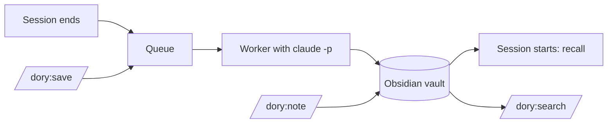

# 🐠 Dory

A memory for Claude Code. When a session ends, a background process writes what was learned in it as notes into an Obsidian vault. When a new session starts, Claude gets the relevant part back: where the project stands, what happened in the last sessions, and what is already known about it.

The notes are plain Markdown. You can open the vault in Obsidian and work with graph, backlinks and search. Notes are written in the language you configure (English by default); code, commands and identifiers stay as they are.

## What you get once the plugin is installed

### What happens on its own

- **When a session ends** (`/exit`, `/clear`, closing the tab, Ctrl+C), it goes into a queue. A worker processes it in the background with `claude -p` and writes:
  - a session note: what was done, which notes came out of it, what is still open
  - knowledge notes: one insight each that will help in a later session (decision, gotcha, how-to, fact, preference). If a note on the topic already exists, it is extended rather than duplicated. If the new insight contradicts an old one, the old note is marked as superseded.
  - the project overview with its open items
  - changes to lists such as the shopping list, if the session touched them
- **When a session starts**, a hook injects what Claude should know: the project and its open items, the last three sessions with their age, the project's knowledge notes and matching knowledge from elsewhere. Whatever does not fit the budget is listed with its path in a catalog.

### Commands in Claude Code

| Command | What it does |
|---|---|
| `/dory:save` | Queues the running session right away without ending it. When it ends later, only the rest is processed, as part 2. |
| `/dory:note "Loki port 3100 clashes with Grafana"` | Writes a note straight into the vault after taking a snapshot. In a project it becomes a knowledge note; `/dory:note "buy milk"` in `~` goes onto the shopping list. |
| `/dory:search loki deploy` | Searches the vault and shows summary and path of each hit. Claude also uses it on its own when you ask about earlier knowledge. |

### In the terminal

```bash
dory status   # queue, failed entries with reason, last error, API equivalent cost
dory retry    # move failed entries back into the queue
```

`dory` lives in the plugin at `plugin/bin/dory`. Installed from GitHub, Claude Code keeps a copy under `~/.claude/plugins/cache/brain/dory/<version>/`; installed from a local clone, it runs straight from the clone.

## Requirements

- macOS (snapshots and transcript copies use APFS clones)
- [Claude Code](https://claude.com/claude-code), signed in with your Claude subscription
- [uv](https://docs.astral.sh/uv/) on your `PATH`; it runs the plugin's Python scripts
- [Obsidian](https://obsidian.md) to browse the notes, optional

## Installation

1. Choose where the vault lives. Without configuration it is `~/Obsidian/dory-brain`. Keep it out of iCloud Drive: iCloud offloads files, and the worker then cannot find them.

   ```bash
   mkdir -p ~/.config/dory-brain
   echo 'vault = "~/Documents/dory"' > ~/.config/dory-brain/config.toml
   ```

2. Add the GitHub repository as a marketplace and install the plugin:

   ```bash
   claude plugin marketplace add cheorges/dory
   claude plugin install dory@brain
   ```

   To work from a local clone instead, pass its path: `claude plugin marketplace add ~/Development/dory`.

3. Restart Claude Code. The hooks run from the next session on.

4. Optional: open the vault in Obsidian (*Open folder as vault*).

To update an installation from GitHub:

```bash
claude plugin marketplace update brain
claude plugin install dory@brain
```

From a local clone, Claude Code loads the plugin in place: changes take effect at the next session start or after `/reload-plugins`.

To remove it:

```bash
claude plugin uninstall dory@brain
```

The vault and the state directory stay where they are.

## Configuration

`~/.config/dory-brain/config.toml`, every value is optional:

```toml
vault = "~/Obsidian/dory-brain"
model = "sonnet"                 # worker model; "haiku" is cheaper
language = "English"             # language the notes are written in, e.g. "German"
recall_budget_tokens = 1500      # upper limit for what a session start injects
short_term_sessions = 3          # last sessions shown at start
min_user_messages = 3            # shorter sessions are skipped
condense_max_tokens = 30000      # upper limit for the condensed transcript
worker_timeout_minutes = 10
snapshots_keep = 50
```

`DORY_VAULT` and `DORY_STATE_DIR` override the vault and the state directory.

## How it works



### Queue

The `SessionEnd` hook copies the transcript (an APFS clone, instant and almost free in disk space) to `~/.local/state/dory-brain/transcripts/` and puts an entry into the queue. It then starts the worker detached and returns at once, so Claude Code never waits for the processing.

### Worker

Only one runs at a time; a file lock makes sure of that. For each entry:

1. The transcript is condensed: only what you and Claude wrote is kept. Tool output, attachments and command wrappers are dropped because they carry foreign text and personal data. Secrets are redacted first. Lines processed before are skipped.
2. A snapshot of the vault is taken (an APFS clone under `~/.local/state/dory-brain/snapshots/`; the last 50 are kept).
3. `claude -p` processes the bundle with the writing rules from `plugin/skills/rules/SKILL.md`. The run is restricted (`--restricted`): it sees only the vault and its own bundle, no CLAUDE.md, no settings, no other plugins.
4. A run only counts as a success if the session note exists. On a rate limit or network error the entry stays in the queue and is retried next time. After three real failures it moves to `failed/`, which `dory status` shows.

### Projects

A project is a git repository. Worktrees belong to their main repository. Sessions outside a repository have no project; their knowledge goes to `general/` or into lists under `notes/`.

### Work and private

Every note has `domain: work` or `private`. In a session in a work project, the start injects nothing private, not even in the catalog, and search does not show it. Outside a repository both are visible. The boundary only applies to what is loaded and searched; Claude can still read the vault directly.

### Ranking at start

Pinned notes first (`pinned: true`), then those with the most sources, then the most recently updated. Superseded notes are never loaded.

## The vault

```text
<vault>/
  projects/
    ai-assistant-hub/
      ai-assistant-hub.md                    project overview (open items, knowledge, sessions)
      ai-assistant-hub-loki-uid-10001.md     knowledge note
  general/
    uv-instead-of-pip.md                     knowledge without a project
  notes/
    shopping-list.md                         list
    invoices.md                              register
  sessions/2026/10/
    2026-10-09-1432-ai-assistant-hub-abc12345-1.md
```

All notes are Obsidian Flavored Markdown with properties in the frontmatter and `[[wikilinks]]`. To pin a note, set `pinned: true`.

### Undoing a change

The vault has no git. A snapshot is taken before every write; you restore a file from there:

```bash
ls ~/.local/state/dory-brain/snapshots/
cp ~/.local/state/dory-brain/snapshots/<timestamp>/projects/x/x-topic.md ~/Documents/dory/projects/x/
```

## Cost

The worker runs on your Claude subscription, not on the API. It removes `ANTHROPIC_API_KEY` from its environment so an API key is never used. The runs count against your usage limit like a normal session.

`dory status` still shows an amount in USD: the API equivalent that `claude -p` reports for every run. Measured on 10 real sessions with `sonnet`, it was 0.18 to 0.35 USD per session, 25 to 60 seconds each. With `model = "haiku"` it is about a fifteenth of that.

## Development

```bash
uv run pytest -q && uv run ruff check .     # tests and linter
DORY_LIVE=1 uv run pytest -m live           # live checks against real claude -p (counts against your limit)
```

The live checks use Haiku; `DORY_LIVE_MODEL=sonnet` picks another model. They run against throwaway vaults.

Design and decisions: [Record 001](docs/records/001-second-brain.md). What was built and checked per story: [implementation log](docs/implementation-log.md).

## License

[Apache License 2.0](LICENSE). You may use, change and redistribute dory, also commercially. Redistributions and products built on it must include the [NOTICE](NOTICE) file, which credits the author. Changes per version are in the [changelog](CHANGELOG.md).
