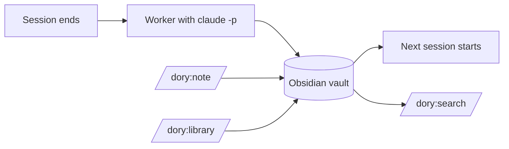

# 🐠 Dory

A memory for Claude Code. Claude forgets everything when a session ends; dory keeps what was learned and gives it back at the next start.

- **When a session ends**, a background worker reads it and writes what matters later into an Obsidian vault: pitfalls, decisions, facts, how-tos. One `knowledge.md` per project, one file per topic for what applies everywhere, and a short note per session.
- **When a session starts**, Claude gets the project's knowledge and your notes for it, plus the topics that fit.
- **In between**, you write down what must not get lost, file knowledge you want to keep, and search everything.

All of it is plain Markdown you can read and edit in Obsidian.



## Install

Needs macOS, [Claude Code](https://claude.com/claude-code) with your Claude subscription, and [uv](https://docs.astral.sh/uv/).

```bash
claude plugin marketplace add cheorges/dory
claude plugin install dory@brain
```

Restart Claude Code. The vault is `~/Obsidian/dory-brain` unless you choose another folder in `/config`; open it in Obsidian with *Open folder as vault*.

## Use

Work as usual: ending a session (`/exit`, `/clear`, closing the tab) is enough. On top of that:

| Command | When |
|---|---|
| `/dory:note "Loki runs on 3200 because Grafana takes 3100"` | Something the next session must know. Claude writes it as a note in the project, or into the matching topic, without asking. |
| `/dory:library "uv instead of pip, because ..."` | Knowledge you want to keep for good. Claude says in a few lines what the entry will hold, then asks for folder, title and links with its proposal preselected; Enter accepts, and only then is it written. |
| `/dory:search loki deploy` | Find earlier knowledge, notes and sessions in the whole vault. |
| `/dory:save` | Process the running session now, without ending it. |

`dory status` in the terminal shows the queue, failed runs and their cost.

## The vault

```text
projects/<project>/knowledge.md     the project's knowledge, kept by the worker
projects/<project>/notes/           your notes for the project
notes/                              topics, lists and registers without a project
library/                            knowledge you filed; loads where a note links it
sessions/                           one note per session
```

The worker never changes your notes or the library, and dory snapshots the vault before every write.

## Configure

In Claude Code: `/config`, then the rows of dory, or `/plugin configure dory@brain`.

| Option | Default |
|---|---|
| Vault folder | `~/Obsidian/dory-brain` |
| Note language | `English`, or German, French, Spanish, ...; any other through `Other (config.toml)` |
| Worker model | `sonnet`, or `haiku` / `opus` |
| Context at session start | `lean` (5 % of the window), `balanced` (10 %), `rich` (15 %) |
| Context window (tokens) | `200000`; set `1000000` for 1M windows |

Changes apply at the next start of Claude Code or after `/reload-plugins`. The rarer settings are in the [guide](docs/guide.md#configuration).

## More

- [Guide](docs/guide.md): what happens when, all commands and settings, the files in the vault, undoing a change, upgrading, cost
- [Records](docs/records/): the design decisions; [changelog](CHANGELOG.md)
- Development: `uv run pytest -q && uv run ruff check .`; live checks against real `claude -p` with `DORY_LIVE=1 uv run pytest -m live`

## License

[Apache License 2.0](LICENSE). Redistributions must include the [NOTICE](NOTICE) file, which credits the author.
