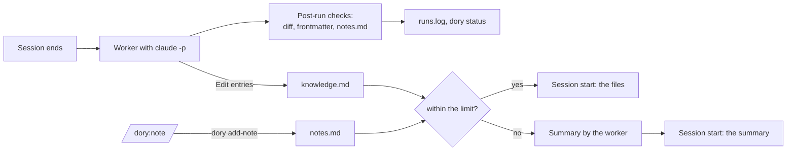

# Record 003: One Knowledge File per Project

## Status

Done (2026-10-19): prepared as 0.4.0 on `feat/knowledge-file`; merge, tag and install by the author

---

## Problem

0.3.0 keeps a project's knowledge as one note per insight in `projects/<project>/`, plus a project overview that links the notes and lists the sessions. Two days after the vault was reset (2026-10-17 to 2026-10-19), ai-assistant-hub holds an overview and 13 knowledge notes with 15,470 characters in all; 16 worker runs with 0.3.0 created 11 new notes.

1. **The knowledge of a project is spread over many files.** To read what dory knows about a project, the user opens the overview and follows one link per note. The session start injects summaries and paths, and whatever does not fit the budget appears only as a path in a catalog. Nowhere does the project's knowledge read as one text.
2. **Keeping single notes current needs machinery.** A stale note is corrected and renamed, a note the CLAUDE.md now covers is deleted. The worker cannot rename or delete, so dory's code carries out its marks after the run and rewrites every link in the vault (`vaultops.py`, 292 lines). In the 19 runs since the reset it was not triggered once (`runs.log`).
3. **The user's own notes and the worker's notes are the same kind of file.** `/dory:note "..."` in a project writes a knowledge note, which later worker runs extend, correct or delete like any other.
4. **What dory adds depends on the repository.** Kolibee's repositories keep status, decisions and pitfalls in a long CLAUDE.md and in records; there the worker rightly finds little that is new. A user without such a setup has nothing that carries the project's knowledge from one session to the next except the vault, and for that user the vault should read like the CLAUDE.md they do not have.

**If nothing changes,** the project folder grows by about one file every second session, the user reads the project's knowledge only note by note, and the rename and delete machinery stays to be maintained for a case that rarely occurs.

**Goal for 0.4.0.** Per project, two files: `knowledge.md`, which the worker keeps current and which holds what matters about the project and is not in the repository, and `notes.md`, which `/dory:note` writes in a project. A new session in the project loads both.

## Options Considered

### Decision 1: Size of `knowledge.md`

#### Option A: A cap at write time
- **Approach:** The worker keeps `knowledge.md` under a configurable limit and condenses or drops the least important points when it is full.
- **Pros:** What the user reads in the file is exactly what the session start injects.
- **Cons:** The worker has to weigh and drop knowledge that still holds, only to fit a context budget.

#### Option B: No cap, the file follows what holds
- **Approach:** `knowledge.md` grows with new knowledge and shrinks when something no longer holds or the repository now says it. Its size has no limit; the session start deals with a large file (decision 6).
- **Pros:** Nothing that holds is dropped for space; the file is the complete knowledge of the project.
- **Cons:** A large file needs a separate path at session start.

#### Option C: A much higher budget
- **Approach:** Raise the session start budget, for example to 4,000 tokens.
- **Pros:** No new mechanism.
- **Cons:** Every session in every project carries more context.

#### Decision

Option B, decided by the user on 2026-10-19. `knowledge.md` is managed: it grows and shrinks with what holds, without a size limit. The limit belongs to the session start (decision 6).

### Decision 2: Protection against silent loss

#### Option A: The snapshot only
- **Approach:** As today, the snapshot before each run is the way back.
- **Pros:** Nothing to build.
- **Cons:** The worker edits the same file in every run; a point it drops by mistake is noticed only by someone looking for it.

#### Option B: Fixed sections, edits, and a diff after the run
- **Approach:** `knowledge.md` has fixed sections with English headings, matching today's note types (pitfalls, decisions, facts, how-to, preferences). The worker changes it with Edit instead of rewriting it. After the run, dory's code compares the old and the new version and writes every removed point to `runs.log`; the session note says what was removed and why.
- **Pros:** Every removal, intended or not, can be traced.
- **Cons:** A diff step in the worker.

#### Decision

Option B, decided by the user on 2026-10-19.

The design review proposed a guard on top: a run that removes more than half of a file's entries is undone and processed again. The user kept option B without it on 2026-10-19. The case the guard blocks also happens legitimately, when a repository's CLAUDE.md takes over the knowledge, and the entry would then end in `failed/`; a loss shows in `dory status`, and the snapshot is the way back.

### Decision 3: The worker and `notes.md`

#### Option A: Read only
- **Approach:** The worker reads `notes.md` so that `knowledge.md` does not repeat it, and never changes it.
- **Pros:** The user's words stay as written.
- **Cons:** A stale entry stays until the user deletes it.

#### Option B: The worker cleans up `notes.md` too
- **Approach:** The worker treats `notes.md` like `knowledge.md`.
- **Pros:** Stale entries go away on their own.
- **Cons:** `notes.md` becomes a second `knowledge.md`, and the reason to keep it separate is gone.

#### Decision

Option A, decided by the user on 2026-10-19. A note is a deliberate act of the user, and the user deletes it again.

### Decision 4: Knowledge without a project

#### Option A: Single notes, as today
- **Approach:** `general/` keeps one file per insight, with ranking, renaming and deleting.
- **Pros:** Nothing changes there.
- **Cons:** Two models in one vault; `vaultops.py` stays for `general/` alone.

#### Option B: One file per domain
- **Approach:** Knowledge without a project goes into one file for work and one for private knowledge, maintained like a project's `knowledge.md`.
- **Pros:** One model in the whole vault; the boundary between work and private becomes a file boundary; `vaultops.py` goes away.
- **Cons:** Existing notes in `general/` are no longer loaded (decision 5).

#### Decision

Option B, decided by the user on 2026-10-19. In addition, `/dory:note` can write general notes from within a project, through the same command: when the user says so ("remember this in general") or the text clearly applies beyond the project.

With decision 3, the user's general notes need a file the worker does not touch. So `general/` (work) and `private/` hold the same pair of files as a project, `knowledge.md` and `notes.md`; the boundary between work and private is the folder. Accepted by the user on 2026-10-19 together with decision 6.

### Decision 5: Existing vaults

#### Option A: A command `dory migrate`
- **Approach:** A one-time command merges a vault's single notes into the new files.
- **Pros:** Explicit; the user sees it happen.
- **Cons:** Public users run `plugin update` and do not know the command.

#### Option B: Automatic migration
- **Approach:** The worker merges a project's single notes into `knowledge.md` in an extra run, and dory's code deletes the old files.
- **Pros:** Nothing to do for the user.
- **Cons:** One extra run per project, and migration code that is used once.

#### Option C: No migration
- **Approach:** Old knowledge notes and project overviews stay in the vault as files and are no longer loaded. The CHANGELOG says so.
- **Pros:** No migration code.
- **Cons:** Knowledge written by 0.3.0 no longer reaches the session start.

#### Decision

Option C, decided by the user on 2026-10-19. dory is at 0.x and may change incompatibly.

### Decision 6: Where the summary for the session start is made

Raised by the user on 2026-10-19: the session start has a limit, and when the files are larger, a summary is loaded instead, so that dory does not weigh on the context. A summary takes a model run (`claude -p`, 10 to 30 seconds); the `SessionStart` hook runs before the user can type, and without a network `claude -p` hangs instead of failing.

#### Option A: At session start, with a cache
- **Approach:** The hook summarizes when the files changed since the last summary, and reuses it otherwise.
- **Pros:** The summary is always current.
- **Cons:** The first session start after every change waits 10 to 30 seconds, without a network until the timeout.

#### Option B: In the background, by the worker
- **Approach:** The worker builds the summary after a run that changed one of the files, and after `/dory:note`. The session start takes the finished summary; when there is none yet, it loads the files cut at the limit, with their paths, and starts the worker.
- **Pros:** The session start never waits.
- **Cons:** Right after a change, the summary can be one state behind.

#### Decision

Option B, decided by the user on 2026-10-19.

## Solution

The worker maintains one file per scope instead of one note per insight; the user's notes get a file of their own; dory's code checks every run against a baseline; the session start loads the files, or a summary the worker made beforehand when they exceed the limit.



### The vault

| Path | Written by | Holds |
|---|---|---|
| `projects/<project>/knowledge.md` | worker | the project's knowledge; the frontmatter carries the project line and the domain |
| `projects/<project>/notes.md` | `/dory:note` | the user's notes for the project |
| `general/knowledge.md` | worker | knowledge without a project, domain work |
| `general/notes.md` | `/dory:note` | the user's general notes, domain work |
| `private/knowledge.md` | worker | knowledge without a project, domain private |
| `private/notes.md` | `/dory:note` | the user's private notes |
| `notes/<name>.md` | worker, `/dory:note` | lists and registers, unchanged |
| `sessions/<YYYY>/<MM>/<...>.md` | worker | session notes, unchanged except `projects` and `## Insights` |

- **Only these two files are current** in `projects/<project>/`, `general/` and `private/`. Any other file there comes from an earlier version (0.3.0 knowledge notes and project overviews); dory's code and the worker never read or write it (decision 5).
- **Links.** Every file of a kind has the same name, so a link to one uses the path form with an alias: `[[projects/ai-assistant-hub/knowledge|ai-assistant-hub]]`. The rule that file names are unique across the vault still holds for every other file (session notes, lists, registers).

### `knowledge.md`

```markdown
---
type: knowledge
domain: work
summary: <project only: one sentence on what the project is about>
paths: ["<project only: repo path>"]
updated: 2026-10-19
---
## Pitfalls
- **Loki only starts if UID 10001 owns the data directory.** The container runs as UID 10001 and exits at start on a root-owned directory. Run `chown -R 10001` on it before deploying.

## Facts
- **The customer VMs reach the internet only through the proxy on port 3128.** ...
```

- **Entries.** One entry is one bullet at column 0 that opens with its core statement in bold, followed by at most three sentences (why, how to apply).
- **Sections** `## Pitfalls`, `## Decisions`, `## Facts`, `## How-to`, `## Preferences`, in this order and with these English headings, matching the note types of 0.3.0 (gotcha, decision, fact, howto, preference). A section without entries is left out.
- **The frontmatter belongs to dory's code.** Before a run, the code creates any of the three files the run may write (the project's, `general/`, `private/`) that is missing, with `type`, `domain` (`work` for a project), `paths` and `updated`. The worker writes `summary` (the project line) and the sections; it never changes `type`, `domain` or `paths`, and the post-run checks restore them if it did. A project becomes private by hand: the user sets `domain: private` in its `knowledge.md` (README). The one exception to decision 5: when the skeleton of a project is created and the project's 0.3.0 overview says `domain: private`, the skeleton takes that domain, so a project the user had marked private does not turn into a work project. Under `general/` and `private/` the folder decides the domain.
- **What goes in** follows the 0.3.0 rules, carried over: the bar ("would someone working in this repository tomorrow, reading the CLAUDE.md and the code, make a mistake or lose time without it?"), the Grep check against the captured CLAUDE.md and records, a record pointer only for what matters beyond the record's feature, the current state only, no project status, identifiers with their subject, the user as "the user". New: nothing the `notes.md` of the same scope says. When the session shows that a user note is wrong, the worker writes the corrected entry into `knowledge.md` and names the outdated note under `## Open` of the session note, so the user can delete it; the note itself stays (decision 3).
- **Keeping it current.** The worker extends or corrects an entry in place; a contradicted entry gets a new bold lead. An entry the CLAUDE.md now states is removed. The file has no size limit (decision 1).
- **Where.** The worker writes the session's project file, `general/knowledge.md` for what applies everywhere, and `private/knowledge.md` for content of the private domain (the placement rules of 0.3.0 for `general/` carry over). A private project's session never writes `general/`, which every work session loads: the task does not offer it, and the post-run checks report a write to it. It never writes another project's file; the multi-project `projects` list of 0.3.0 goes away, and knowledge about a sibling project stays in the session's project.
- **Reading.** The worker reads the project's `knowledge.md` and `notes.md` in full and searches `general/` and `private/` with Grep for each insight's key terms instead of reading them whole, so a run's input grows with the project, not with the vault.

### `notes.md` and `/dory:note`

```markdown
---
type: notes
---
- 2026-10-19: Loki port 3100 clashes with Grafana on the customer VMs
```

- One dated bullet per note, in the user's words as written (not translated), newest last. No `domain`: the folder or the project's `knowledge.md` decides. The user edits and deletes entries by hand; the worker never changes the file (decision 3), and the post-run checks enforce it.
- **`dory add-note --scope project|general|private "<text>"`** does the writing deterministically: it appends the dated bullet, creates the file with its frontmatter if missing, marks the context for a new summary, starts the worker and prints the file. `project` outside a repository is an error. The model in the note skill only chooses the scope: in a project `project`; `general` when the user says it applies in general or the text clearly has nothing to do with the project; `private` when the content falls under the private domain. Outside a project `general` or `private`.
- **Lists and registers** under `notes/` stay reachable from every session, inside a project too ("add milk to the shopping list"); the model edits them as before.
- `dory prepare-note` names the project, its domain (from its `knowledge.md`), the three scopes with their paths and the rules.

### The worker run

- **Baseline.** Before each attempt of an entry, the code stores in `<state>/baselines/<entry>/` (outside the bundle directory, which the run can write) a copy of the three knowledge files the run may write and of every `notes.md`, and a hash of every other `.md` under `projects/`, `general/` and `private/`. Each attempt is checked against its own baseline and reports its own changes, so what the user or another entry changes between two attempts is neither undone nor counted again. Only when an attempt ended before its checks ran (a killed worker) does the next attempt keep that baseline, so the killed run's changes are still checked. The baseline is removed when the entry leaves the queue.
- **Task.** `task.md` names the session note, the three knowledge files to write, the project's `notes.md` to read, the `general/` and `private/` files to search, and that every other file in those folders is from an earlier version. The project overview and the list of known projects are gone from the task.
- **The command** gets a permission rule in its `--settings` that denies Edit and Write on `**/notes.md` (a live probe shows whether restricted mode honours it; the post-run checks hold either way).
- **Ingest skill.** Read the knowledge and notes files, determine the insights, change entries with Edit, update lists, write the session note last.
- **Session note.** `projects: ["[[projects/<project>/knowledge|<project>]]"]`. `## Insights` has one line per entry: `- [[projects/<project>/knowledge|<project>]]: **<lead>** (added)`, `(changed)` or `(removed: <reason>)`.
- **Post-run checks** (decision 2), after every outcome that changed a file:
  1. **Frontmatter.** `type`, `domain` and `paths` of the three knowledge files are restored from the baseline if missing or changed.
  2. **`notes.md`.** A changed `notes.md` is restored from the baseline. The checks run only when the run changed the vault, but they cannot tell the run's writes from the user's: an edit the user makes by hand while a run is going (20 to 60 seconds) is undone and logged as `restored`. `dory add-note` writes its line into the baselines of queued entries as well, so a note added during a run stays.
  3. **Unexpected files.** A new or changed `.md` under `projects/`, `general/` or `private/` other than the three knowledge files is logged, not restored; the snapshot holds the old version.
  4. **Diff** of the three knowledge files against the baseline, by one parser module that search uses as well. An entry is a bullet at column 0 up to the next such bullet or heading; text outside bullets counts as an entry too, so its loss shows. Its key is the bold lead, normalized (case, whitespace, bullet character, trailing punctuation); without a bold lead, the first 80 normalized characters; a duplicate key gets a counter. Same key with another text or section: `changed`. A key that is gone is paired with a new key in the same file when the two entries are similar: a difflib ratio of at least 0.5 on the whole texts, or on the leads when the new lead keeps every word of the old one except its numbers (so a short entry corrected into a longer one still pairs, and "Loki runs on port 3100" does not pair with "Loki needs chrony"). A paired entry is `changed`, with the old lead. Short entries built on one pattern can still pair by their whole text, so a changed entry with an old lead is counted as a rewritten lead in `dory status`, where a wrong pairing stays visible. Only unpaired entries are `removed` or `added`.
  5. **A run that removes most of a file** is logged like any other removal and not undone (decision 2).
- **runs.log.** `vault_changes` holds objects: `{"change": "added" | "changed" | "removed" | "restored" | "unexpected", "file": ..., "lead": ..., "was": ...}`. `dory status` shows today's (local time) number of removed entries, rewritten leads, restored and unexpected files and failed checks, summed over the day's runs.
- **Snapshot.** On a transient outcome the snapshot is deleted only if the vault did not change.
- **What goes away.** `vaultops.py` with its tests, the marks `rename_to` and `status: archived`, the reset of earlier marks, the multi-project `projects` list and the known projects in the task.

### The session start

| Session in | Loads |
|---|---|
| a work project | the project's `notes.md` and `knowledge.md`, then `general/notes.md` and `general/knowledge.md` |
| a private project | the same, then `private/notes.md` and `private/knowledge.md` |
| no repository | `general/`, then `private/` |
| a repository dory does not know yet | `general/` |

- **Fixed paths.** The session start reads these files and the list of `notes/*.md`; it no longer scans the whole vault. The project comes from `projects.json` as today, its domain from its `knowledge.md`; before that file exists, from a 0.3.0 overview that says `domain: private`, the domain its skeleton will take, and `work` otherwise.
- **Order:** header, project line (the `summary` of the project's `knowledge.md`, or that the vault has no knowledge for the project yet), sessions still in the queue, the files in the order of the table, each under `## <path>` with its own headings one level down, then the paths of lists and registers.
- **The limit** is `recall_budget_tokens` (default 1,500) and covers the whole injected text. While everything fits, the files load as they are.
- **Over the limit:** the context's summary instead of the files, with the files' paths for reading the full text. The summary is made to at most 80 % of the limit, so the rest fits. If the files changed since the summary was made, the old summary still loads, with a line that the files are newer, unless it was made for another domain; then, and when there is no summary yet, the files load cut at the limit in the order of the table, with a marker. In each of these cases the session start marks the context and starts the worker. It never runs `claude` itself.
- **One threshold for both sides.** A summary is for a context whose text (the files as `context.text` builds them) exceeds the summary's target of 80 % of the limit; the session start and the worker apply this same test. When the whole injected text exceeds the limit but the files stay within the target, the other parts (queue lines, list paths) pushed it over: the files load cut as above and nothing is marked, since a summary would not be shorter. (Found in the S3 review: with the whole text on one side and the files on the other, such a context would be marked at every session start and skipped by every pass.)
- **Domain boundary** as before: a work project loads nothing from `private/`, not even a path.

### Summaries (decision 6)

- **Context.** One summary per context: a known project (`project-<name>`; the prefix keeps a repository directory named `_general` apart from the reserved names), `_general` for a repository dory does not know yet, `_outside` for sessions outside a repository. A context covers exactly what its session start loads, so a summary can weigh project and general knowledge against each other. The price: a change in `general/` makes every summary that covers it stale; each is rebuilt when its next session start marks it.
- **Text and hash.** One function builds a context's text for the session start and the worker alike: the file bodies without frontmatter, in the load order, each under its path. The hash covers that text, the domain, the note language and the limit, so a config change rebuilds too. The worker hashes exactly the text it sends to the model. The summary file `<state>/summaries/<context>.md` holds hash and domain in its header and is written atomically.
- **Marking.** A context is marked by touching `<state>/summaries/<context>.wanted` (the session start, `dory add-note`). Parallel session starts touch the same file and write nothing else. The worker removes the mark before the job.
- **When.** After draining the queue, under the lock, also when the queue was empty: for the project of every entry the pass processed and for every marked context, when its text exceeds the summary's target (80 % of the limit, the test the session start applies) and the hash differs. Skipped when the pass stopped on a transient outcome or a timeout; a summary job that ends that way ends the summary jobs of the pass. One try per context and pass; a hash that failed three times is not tried again until the text changes. The check for new work after the lock is released also looks at marks. An exception in a summary job is logged and never stops the worker.
- **The run.** `claude -p` with `--restricted --tools "" --strict-mcp-config --settings '{"disableAllHooks": true}' --system-prompt <summary rules> --max-turns 1 --no-session-persistence --output-format json` and a small `--max-budget-usd`, the configured model, the worker's environment (no API key, `DORY_WORKER=1`), a working directory without CLAUDE.md, the text on stdin. The system prompt frames the text as data and asks for the summary only: at most the target length, in the note language, pitfalls and decisions with their consequence before detail, the gist of the user's notes. The `result` field is the summary; an error or an empty result is a failure; a code fence or a preamble line is stripped; output over the target is cut with a marker. Timeout 3 minutes. A line in `runs.log` with `kind: summary`, the context and the cost.

### Search

- `/dory:search` scores each entry of a `knowledge.md` or `notes.md` on its own (with the parser of the post-run checks), each session note and each list, and shows the matching entry with its file path.
- **Domain boundary:** `general/` is work and `private/` private by folder; `projects/<project>/` follows the project's `knowledge.md`; session notes and lists follow their own `domain`.
- Old knowledge notes and project overviews of 0.3.0 are neither loaded nor searched (decision 5).

### What stays

The queue, condensing, the bundle with the captured repository documents, snapshots, session notes, lists and registers, and the settings; `recall_budget_tokens` becomes the limit for the summary.

### Risks

- **One file, edited by a model in every run.** The post-run checks make a lost entry visible and protect the frontmatter and the user's notes; they do not prevent a loss inside `knowledge.md`. Live checks have to show that a run extends a full file without dropping entries.
- **A run's input grows with the project.** The worker reads the project's file in full in every run; the hub held 15,470 characters after two days. A run costs more as the file grows, and one that reaches `MAX_BUDGET_USD` (1.0) fails. A live check at that size measures the cost with Haiku and Sonnet.
- **Same file names everywhere.** Obsidian's tabs and quick switcher show `knowledge` for every project; the folder tells them apart.
- **Sessions started before the update** keep running the 0.3.0 worker until restarted or `/reload-plugins`, and it writes single notes that 0.4.0 never loads.

### Not part of this record

- What happens to the author's current vault, with its 0.3.0 notes: decided at the release.
- The configurable records folder, pruning `work/`, and the narrower Bash grant for `/dory:save` and `/dory:note` stay in the Future table; `dory add-note` makes the narrower grant for `/dory:note` easier.

## User Stories

Order by risk and dependency: S1 builds the entry parser and the post-run checks; they are deterministic, and S2's live checks read their results in `runs.log`, as S6 searches entries with the same parser. S2 changes what the worker writes and carries the highest risk. S3 loads the new files, S4 adds the summary on top of S3's fallback, S5 needs S4's marking. Between S2 and S5 the branch is not releasable: S2 rewrites the rules that `/dory:note` shares, so `tests/test_live_note.py` is skipped until S5, and the session start reads the overview's domain until S3. The installed 0.3.0 is not affected.

**Live checks** run against real `claude -p` with Haiku in throwaway vaults. Each new check passes in three of three runs before its story counts as done. Every negative check ("nothing is written") has a positive control in the same transcript, a second insight that must produce an entry, so an empty run cannot pass; where a check has no possible control, the criterion says so.

### Story S1: Entries and post-run checks

**As a** user whose project knowledge a model edits after every session
**I want** dory to compare each run against the state before it, protect the frontmatter and my notes, and report every removed entry
**So that** a lost entry shows up in `dory status` instead of going unnoticed

**Acceptance Criteria (unit tests, with a fake runner where a run is needed):**
- [ ] Given a knowledge file with bold-lead entries, an entry without a bold lead, two entries with the same lead and a loose paragraph, when it is parsed, then each is one entry with its normalized key, the duplicate gets a counter, and the paragraph counts as an entry.
- [ ] Given a file before and after a run with one entry added, one body changed, one lead corrected with otherwise similar text, one entry moved to another section and one removed, when the diff runs, then it reports one `added`, three `changed` (the corrected one with its old lead) and one `removed`.
- [ ] Given a project without `knowledge.md`, when a run is prepared, then the file exists with `type: knowledge`, `domain: work`, `paths` and `updated`; given a run that changed `domain` or dropped the frontmatter, then `type`, `domain` and `paths` are restored and logged as `restored`.
- [ ] Given a run that changed a `notes.md`, when the checks run, then the file is byte-identical to the baseline again and the change is logged as `restored`.
- [ ] Given a run that wrote into a 0.3.0 note or created another `.md` under `projects/`, `general/` or `private/`, when the checks run, then each such file is logged as `unexpected`.
- [ ] Given an entry whose first attempt hits the rate limit after removing an entry from a knowledge file, and a `notes.md` the user edits before the retry, when both attempts are checked, then the first attempt's line reports the removal, the retry's line does not repeat it, the user's edit stays, and the first attempt's snapshot was kept because the vault had changed; given an attempt that ended before its checks ran, then the next attempt keeps its baseline.
- [ ] Given `runs.log` with three removed entries over two attempts of one entry and one more entry, one restored file and one failed check today in local time, and one removal yesterday, when `dory status` runs, then it shows three removed entries, one restored file and one failed check for today.
- [ ] Given the post-run checks, when they hit a file they cannot read or write, then the entry's outcome stays what the run produced and the failure is in `runs.log`; given a dangling link or an unreadable `.md` in a scope folder, then the baseline is still taken.

**Priority:** High
**Status:** Done (2026-10-19)

### Story S2: The worker keeps one knowledge file per scope

**As a** user who reads what dory knows about a project
**I want** the worker to keep it in one `knowledge.md` per project, and in `general/` and `private/`, growing and shrinking with what holds
**So that** I read the project's knowledge as one text and nothing outdated stays in it

**Acceptance Criteria:**
- [ ] Given a restricted worker run whose `--settings` deny Edit and Write on `**/notes.md`, when the model tries to change a `notes.md`, then the file is unchanged (live probe, built first; the outcome decides whether the rule stays in the command).
- [ ] Given a project with the skeleton only and a transcript of a build session without an insight, when the worker runs, then `knowledge.md` has a `summary` and no section, and the session note exists (live check; no positive control possible, the bar is what is tested).
- [ ] Given a transcript with one real pitfall, when the worker runs, then `knowledge.md` has an entry under `## Pitfalls` that opens with its core statement in bold followed by at most three sentences, and the session note lists it under `## Insights` in the fixed format as added (live check).
- [ ] Given a `knowledge.md` of about 40 entries and 15,000 characters and a transcript with one new insight, when the worker runs, then the post-run diff reports no removed entry and one added; run with Haiku and once with Sonnet, with the cost of each in the implementation log (live check).
- [ ] Given an entry that Loki listens on port 3100 and a transcript in which Loki moves to port 3200, when the worker runs, then exactly one entry is about the Loki port, it says 3200, and `runs.log` lists it as `changed`, not removed (live check).
- [ ] Given an entry whose content the bundle's CLAUDE.md now states and a new insight in the same transcript, when the worker runs, then the entry is gone and logged as `removed`, the session note names the reason, and the new insight is an entry (live check).
- [ ] Given a `notes.md` entry that the transcript repeats and a second, new insight, when the worker runs, then `notes.md` is byte-identical, `knowledge.md` does not repeat the note, and the second insight is an entry (live check).
- [ ] Given a `notes.md` entry that the transcript shows to be wrong, when the worker runs, then `knowledge.md` holds the corrected statement, `notes.md` is unchanged, and the session note names the outdated note under `## Open` (live check).
- [ ] Given a project session that yields a fact about a tool unrelated to the project, a fact about the project's own stack, and a fact about the user's home NAS, when the worker runs, then the first lands in `general/knowledge.md`, the second in the project's file, and the third in `private/knowledge.md` and nowhere else (live check).
- [ ] Given a 0.3.0 note on Loki in the project folder and a transcript with a Loki insight, when the worker runs, then the insight is an entry in `knowledge.md` and the old note is byte-identical (live check).
- [ ] Given the code, the rules and the ingest skill, when they are reviewed, then `vaultops.py`, `rename_to`, `status: archived`, the project overview and the known projects are gone; the rule checks of 0.3.0 that still apply (language, injection, identifiers, people) pass against the new format; the implementation log lists which live tests were ported and which were dropped; a unit test covers the new `task.md` (review, live suite, unit test).

**Priority:** High
**Status:** Done (2026-10-19)

### Story S3: The session start loads the files

**As a** user starting a session in a project
**I want** the session start to load the project's and the general `notes.md` and `knowledge.md` as they are, while they fit the limit
**So that** Claude knows what the vault knows about the project, not only summaries and paths

**Acceptance Criteria (unit tests):**
- [ ] Given a work project with `notes.md` and `knowledge.md`, files in `general/` and in `private/`, all together under the limit, when a session starts, then the injected text holds the project line from the `summary` and the four project and general files without frontmatter in the order notes, knowledge, each under `## <path>` with its own headings one level down, and nothing from `private/`.
- [ ] Given a project whose `knowledge.md` says `domain: private`, or a session outside a repository, when a session starts, then `private/notes.md` and `private/knowledge.md` load as well; given a repository dory does not know yet, then `general/` loads.
- [ ] Given files over the limit and no summary, when a session starts, then the injected text stops at the limit with a cut marker, in the order of the load table, and names the paths of all files of the context.
- [ ] Given header, queue lines and list paths, when the limit is measured, then they count against it.
- [ ] Given lists and registers under `notes/`, when a session starts, then their paths appear as before; given 0.3.0 knowledge notes and a project overview, then none of their text or paths appear.
- [ ] Given a project with `notes.md` but no `knowledge.md`, when a session starts, then the notes load and the project line says that the vault has no knowledge for the project yet; given a session of the project still in the queue, then the "Not processed yet" line appears as before.

**Priority:** High
**Status:** Done (2026-10-19)

### Story S4: A summary when the files exceed the limit

**As a** user with a lot of knowledge in a project
**I want** the session start to load a summary the worker made beforehand when the files exceed the limit
**So that** dory's share of the context stays within the limit and the session start never waits for a model

**Acceptance Criteria:**
- [ ] Given the summary command (no tools, own system prompt, the text on stdin, one turn, hooks off), when it runs, then it returns the summary as its `result` and no queue entry or session file of dory appears (live probe, built first).
- [ ] Given a context, when the session start and the worker build its text, then both texts are identical; given another note language or limit, then the hash differs (unit test).
- [ ] Given a project whose text exceeds the summary's target, when the worker processes a session of that project, then `<state>/summaries/project-<name>.md` holds hash and domain in its header and at most 80 % of the limit, cut by dory's code if the model wrote more, and `runs.log` has a `kind: summary` line with its cost (unit test with a fake runner; one live check for length and note language).
- [ ] Given a summary whose hash matches, when a session starts, then the summary loads instead of the files, with the files' paths (unit test).
- [ ] Given files that changed since the summary, when a session starts, then the old summary loads with a line that the files are newer, the context is marked and the worker starts, and the next pass rebuilds it; given a summary made for another domain, then the files load cut instead (unit tests).
- [ ] Given files over the limit and no summary, when a session starts, then the files load cut as in S3, the context is marked and the worker starts; given an empty queue and a mark, when the worker runs, then it builds the summary (unit tests).
- [ ] Given a context within the summary's target, when the pass ends, then no summary run happens (unit test).
- [ ] Given a summary run that fails transiently or times out, when the pass ends, then the old summary stays, no further summary job runs in that pass, and no queue entry is affected; given a text whose summary failed three times, then it is not tried again until the text changes; given an exception in a summary job, then the worker still finishes (unit tests).

**Priority:** High
**Status:** Done (2026-10-19)

### Story S5: `/dory:note` writes the user's notes

**As a** user who wants something remembered right now
**I want** `/dory:note` to add it to the project's `notes.md`, or to `general/` or `private/` when it applies beyond the project
**So that** my own words reach later sessions and the worker never rewrites them

**Acceptance Criteria:**
- [ ] Given `dory add-note --scope project "<text>"` in a project, when it runs, then the project's `notes.md` gains one bullet dated today with the text (created with its frontmatter if missing), the context is marked, the worker starts and the path is printed; given an unknown scope, or `project` outside a repository, then it fails with a message and writes nothing (unit tests).
- [ ] Given `dory prepare-note` in a project, when it runs, then its output names the project, its domain from `knowledge.md` and the three scopes with their paths (unit test).
- [ ] Given a worker run in progress whose baseline holds the project's `notes.md`, when `dory add-note` appends to that file, then the post-run checks of the run keep the new line (unit test).
- [ ] Given a session in a project, when the user runs `/dory:note "Loki port 3100 clashes with Grafana"`, then the entry is in the project's `notes.md` in the user's words, `knowledge.md` is unchanged, and the reply names the file (live check).
- [ ] Given a session in a project, when the user runs `/dory:note "remember in general: Python packages with uv instead of pip"`, then the entry is in `general/notes.md` and the project's `notes.md` is unchanged (live check).
- [ ] Given a session in a work project, when the note is about the user's own home NAS, then it is in `private/notes.md` (live check).
- [ ] Given a session in a project, when the user notes "add milk to the shopping list", then it goes onto the shopping list under `notes/` and no `notes.md` changes; given a session outside a repository, "buy milk" does the same (live check).

**Priority:** Medium
**Status:** Done (2026-10-19)

### Story S6: Search finds single entries

**As a** user looking for something dory knows
**I want** `/dory:search` to show the matching entries of the knowledge and notes files, besides session notes and lists
**So that** a hit shows the statement itself instead of a file that holds twenty

**Acceptance Criteria (unit tests):**
- [ ] Given a `knowledge.md` with an entry on Loki and one on Grafana, when the user searches "loki", then the Loki entry is a hit with its file path and the Grafana entry is not.
- [ ] Given a session in a work project, when the user searches, then no entry from `private/` and none from a project whose `knowledge.md` says `domain: private` is shown; outside a repository both are.
- [ ] Given session notes and lists that match, when the user searches, then they are found as before, by their own domain.
- [ ] Given 0.3.0 knowledge notes and a project overview that match, when the user searches, then they are not shown.

**Priority:** Medium
**Status:** Done (2026-10-19)

### Story S7: Release 0.4.0 prepared

**As a** user of the public plugin
**I want** these changes as version 0.4.0 with a changelog entry
**So that** `claude plugin update dory@brain` brings them and I know what happens to my old notes

**Acceptance Criteria:**
- [ ] Given the three version files, when the version test runs, then all of them say 0.4.0 and the test is green.
- [ ] Given the CHANGELOG, when a user reads the 0.4.0 entry, then it names `knowledge.md` and `notes.md` per project, in `general/` and in `private/`, the summary over the limit, the post-run checks in `runs.log` and `dory status`, where `/dory:note` writes, that knowledge about a sibling project now stays in the session's project, that 0.3.0 knowledge notes and project overviews are no longer loaded or searched and can be deleted, and that sessions started before the update need a restart or `/reload-plugins`.
- [ ] Given the README and the project CLAUDE.md, when they describe the vault, the session start and the commands, then they say how to mark a project private and no longer mention knowledge notes as files, renaming or the project overview (review).
- [ ] Given the release commit on the feature branch, when the branch is inspected, then nothing is tagged or pushed; merging, tagging, pushing and installing stay with the author.

**Priority:** Medium
**Status:** Done (2026-10-19)
